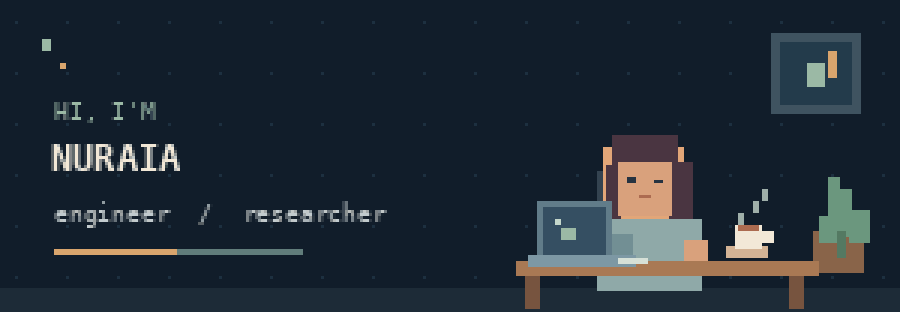
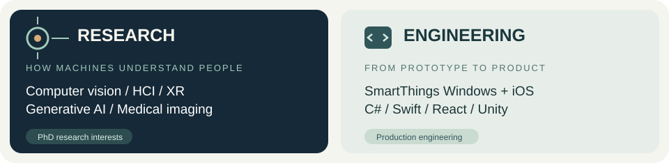
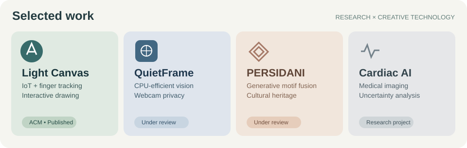
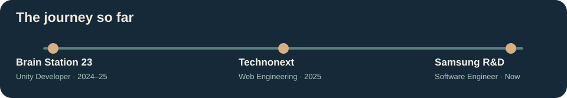

 

  

  <h1>Nuraia Nahrin Fahmida</h1>

  
<strong>Software Engineer @ Samsung R&D &nbsp; | &nbsp; Aspiring PhD Researcher</strong>

  
<em>Exploring how machines see, learn, and interact with people.</em>

  
  
  

 

  

### Hello, I'm Nuraia.

I'm a **Computer Science & Engineering graduate from MIST** and a software engineer building **SmartThings experiences on Windows and iOS**. Beyond production code, I investigate **human-centered AI**—particularly computer vision, intelligent interactions, XR, and accessible computing.

 

  

  <strong>Publication notes:</strong> Light Canvas — ACM, 2025 &nbsp;·&nbsp; Educational Gaming for Child Safety — IEEE, 2025 &nbsp;·&nbsp; QuietFrame and PERSIDANI — under review

 

  

 

  <h3>My working toolkit</h3>
  

    
  

  AI & Computer Vision &nbsp; • &nbsp; Interactive Systems &nbsp; • &nbsp; Product Engineering

 

  <a href="https://nuraia.github.io/"><strong>View portfolio</strong></a>
  &nbsp; · &nbsp;
  <a href="mailto:nuraianahrinfh@email.com"><strong>Discuss research or collaboration</strong></a>

  
<em>Thoughtful research. Useful technology. Human-centered design.</em>

